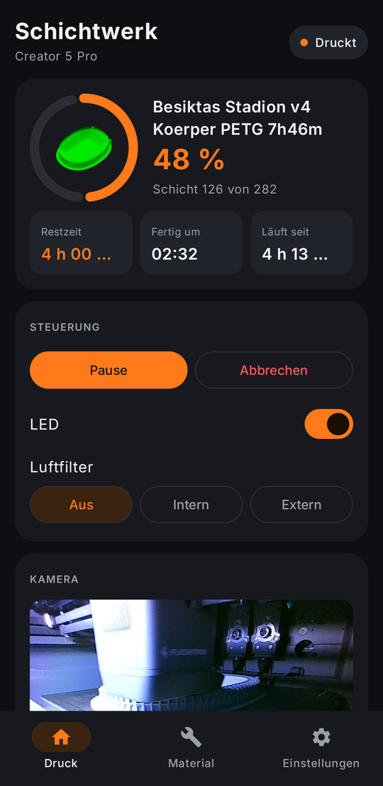

# Schichtwerk

Android-App für den FlashForge Creator 5 Pro. Sie spricht ausschließlich mit Home Assistant
(REST-API) und nutzt die Entitäten, die dort schon vorhanden sind.

  
  

## Funktionen

- **Druck:** Fortschritt, Schicht, Restzeit, Druckende, Vorschaubild, Kamera, Temperaturen mit Verlauf seit Druckstart
- **Steuerung:** Pause, Fortsetzen, Abbrechen (mit Rückfrage), Geschwindigkeit, LED, Luftfilter
- **KI-Kontrolle:** Schalter und Schwelle der KI-Fehldruckerkennung des Drucker-Bots
- **Material:** Spulenfarbe, Material und Restmenge je Slot, Preise je Slot, Wartung abhaken, Kosten und Verbrauch
- **Verlauf:** alle beendeten Drucke aus dem Kalender „3D-Drucke“ mit Monatssummen
- **Live-Anzeige:** Dauerbenachrichtigung mit Fortschritt, nur solange ein Druck läuft
- **Alarme:** Fehler, Pause, gestoppt, Druck fertig mit Kamerabild, Spule fast leer
- **Widget:** Status, Fortschritt und Restzeit auf dem Homescreen
- **Updates:** Hinweis auf neue Versionen mit Link zum Download (GitHub-Token mit Leserecht nötig)

## Einrichten

1. APK aus dem neuesten [Release](../../releases) laden und installieren.
2. In Home Assistant ein langlebiges Zugriffstoken anlegen (Profil → Sicherheit).
3. In der App Adresse und Token eintragen, optional eine zweite Adresse für unterwegs. Ist eine
   der beiden nicht erreichbar, wechselt die App automatisch zur anderen.
4. Unter *Einstellungen → Hintergrund* die Akku-Optimierung ausschalten, damit die Live-Anzeige
   auch bei geschlossener App startet.
5. Für die Geschwindigkeit unter *Einstellungen → Drucker direkt* IP-Adresse, Seriennummer und
   Prüfcode eintragen. Der Befehl geht direkt an den Drucker und klappt nur im Heimnetz.

Das Token wird mit dem Android Keystore verschlüsselt und nur auf dem Gerät gespeichert.

## Bauen

Jeder Push auf `main` baut über GitHub Actions eine signierte APK und legt ein Release an.
Pull Requests werden genauso gebaut und getestet, aber ohne Release.
Lokal: `./gradlew testDebugUnitTest assembleRelease` (JDK 17, Android SDK 37).

Die Entity-IDs stehen in `app/src/main/java/de/uekala/schichtwerk/data/Snapshot.kt` (`Ids`).

## Signatur

`signing/sideload.jks` ist ein reiner Sideload-Schlüssel, damit Updates sich über die
vorherige Version installieren lassen. Bevor das Repo öffentlich wird, gehört der Schlüssel
in ein GitHub-Secret.
