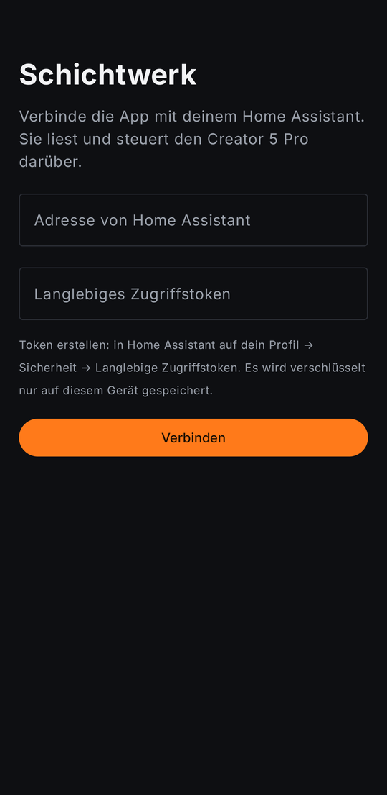

# Schichtwerk

Android-App für den FlashForge Creator 5 Pro. Sie spricht ausschließlich mit Home Assistant
(REST-API) und nutzt die Entitäten, die dort schon vorhanden sind.

<p>
  
  
</p>

## Funktionen

- **Druck:** Fortschritt, Schicht, Restzeit, Druckende, Vorschaubild, Kamera, Temperaturen mit Verlauf seit Druckstart
- **Steuerung:** Pause, Fortsetzen, Abbrechen (mit Rückfrage), Geschwindigkeit, LED, Luftfilter
- **KI-Kontrolle:** Schalter und Schwelle der KI-Fehldruckerkennung des Drucker-Bots
- **Material:** Spulenfarbe, Material und Restmenge je Slot, Preise je Slot, Wartung abhaken, Kosten und Verbrauch
- **Verlauf:** alle beendeten Drucke aus dem Kalender „3D-Drucke“ mit Monatssummen
- **Live-Anzeige:** Dauerbenachrichtigung mit Fortschritt, nur solange ein Druck läuft
- **Alarme:** Fehler, Pause, gestoppt, Druck fertig mit Kamerabild, Spule fast leer
- **Widget:** Status, Fortschritt und Restzeit auf dem Homescreen
- **Updates:** Hinweis auf neue Versionen mit Link zum Download; installieren am einfachsten mit Obtainium

## Einrichten

1. Schichtwerk in [Obtainium](https://github.com/ImranR98/Obtainium) mit der Adresse
   `https://github.com/uekala/schichtwerk` hinzufügen (oder die APK aus dem neuesten
   [Release](../../releases) laden). Updates installiert Obtainium dann über die vorhandene App.
2. In Home Assistant ein langlebiges Zugriffstoken anlegen (Profil → Sicherheit).
3. In der App Adresse und Token eintragen, optional eine zweite Adresse für unterwegs. Ist eine
   der beiden nicht erreichbar, wechselt die App automatisch zur anderen.
4. Unter *Optionen → Hintergrund* die Akku-Optimierung ausschalten, damit die Live-Anzeige
   auch bei geschlossener App startet.
5. Für die Geschwindigkeit unter *Optionen → Drucker direkt* IP-Adresse, Seriennummer und
   Prüfcode eintragen. Der Befehl geht direkt an den Drucker und klappt nur im Heimnetz.

Das Token wird mit dem Android Keystore verschlüsselt und nur auf dem Gerät gespeichert.

## Bauen und Releases

- Push auf `main` und Pull Requests: Tests, Android Lint, Testversion als Artefakt
  (`de.uekala.schichtwerk.test`, heißt „Schichtwerk Test“, läuft neben der echten App) und eine
  Probe der Release-Signatur mit Wegwerf-Schlüsseln. Ein Release entsteht dabei nicht.
- Release: `appVersion` in `gradle.properties` erhöhen, Abschnitt `## X.Y.Z` in `CHANGELOG.md`
  ergänzen und auf `main` bringen. Dann unter *Actions → APK bauen → Run workflow* (Branch `main`)
  den Haken „Release anlegen“ setzen – oder den Tag `mobile-vX.Y.Z` pushen. Die CI baut, signiert
  und prüft die APK, legt den Tag an und veröffentlicht das Release „Schichtwerk Mobile X.Y.Z“ mit
  `schichtwerk-X.Y.Z.apk`. Ein von Hand angelegtes Release mit diesem Tag ergänzt sie um APK und Text.
- `versionCode` ist die Laufnummer des Workflows und steigt deshalb mit jedem Build.
- Lokal: `./gradlew testDebugUnitTest assembleDebug` (JDK 17, Android SDK 37). Lokal gebaute
  Release-APKs sind unsigniert.

Die Entity-IDs stehen in `app/src/main/java/de/uekala/schichtwerk/data/Snapshot.kt` (`Ids`).

## Signatur

Bis 0.1 signierte ein Sideload-Schlüssel aus `signing/`, der öffentlich im Repository lag. Seit 0.2
signiert ein neuer Schlüssel, der nur in den GitHub-Secrets liegt; eine Lineage (Schlüsselrotation,
APK Signature Scheme v3.1) belegt, dass der alte ihn bestätigt hat. Updates lassen sich deshalb weiter
über die installierte App spielen. Ab Android 13 nimmt das Gerät danach keine APK mehr an, die nur mit
dem alten Schlüssel signiert ist.

Einrichtung (einmalig, am eigenen Rechner mit JDK und angemeldetem `gh`):

```bash
curl -fsSLO https://raw.githubusercontent.com/uekala/schichtwerk/main/tools/setup-android-signing.sh
bash setup-android-signing.sh
```

Das Skript holt den alten Schlüssel aus der Git-Historie, erzeugt den neuen und trägt beide als
Secrets ein (`ANDROID_*`, `ANDROID_OLD_*`) sowie den Fingerabdruck als Variable
`ANDROID_SIGNING_CERT_SHA256`. Keystore und Passwort danach in den Passwortmanager.

| Datei | Zweck |
|---|---|
| `tools/sign-release.sh` | signiert die Release-APK mit Rotation |
| `tools/verify-apk-signature.sh` | prüft v3.1, Lineage alt → neu und den Fingerabdruck |
| `tools/signatur-probe.sh` | Probelauf mit Wegwerf-Schlüsseln bei jedem Build |
| `tools/setup-android-signing.sh` | einmalige Einrichtung der Secrets |
